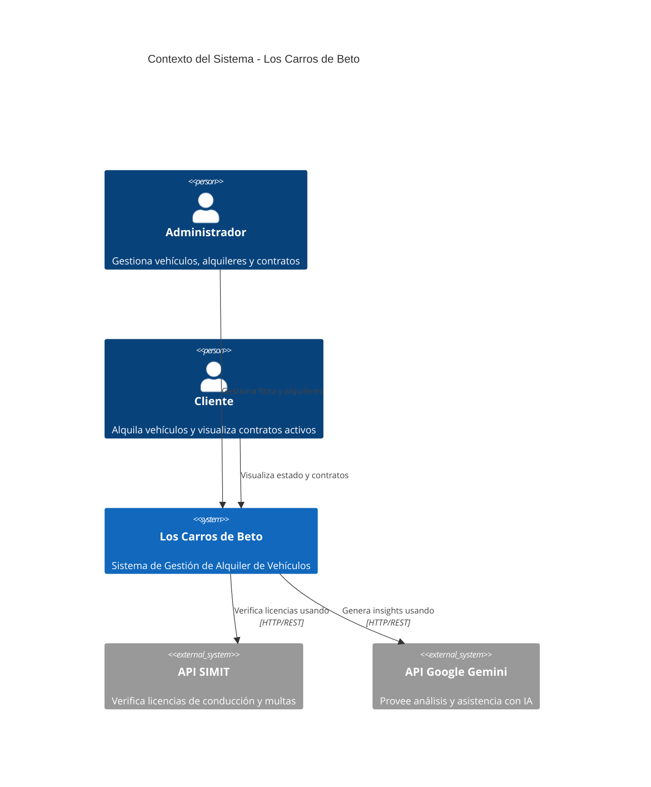
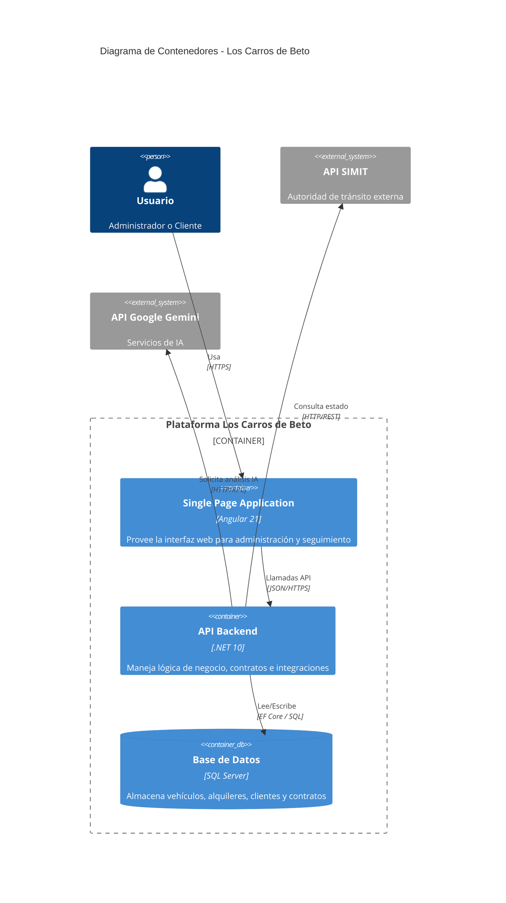

# Documentación Técnica de Arquitectura

## Contexto del Sistema (Nivel 1)

Este diagrama muestra el contexto del sistema para **Los Carros de Beto**, ilustrando cómo el sistema interactúa con los usuarios y servicios externos.

## Contenedores (Nivel 2)

Este diagrama detalla los contenedores de alto nivel dentro del sistema **Los Carros de Beto**, mostrando las elecciones tecnológicas y responsabilidades.

## Decisiones de Arquitectura y Diseño

El sistema ha sido diseñado bajo una arquitectura de **N-Capas Modernas**, separando claramente el Frontend del Backend para permitir escalabilidad independiente y una mejor experiencia de usuario.

### Stack Tecnológico

| Componente | Tecnología | Versión | Justificación |
|------------|------------|---------|---------------|
| **Frontend** | Angular | 21 | Framework robusto, tipado estático con TypeScript, ideal para aplicaciones empresariales y SPA (Single Page Applications) de alto rendimiento. |
| **Backend** | .NET | 10 | Plataforma unificada de alto rendimiento, multiplataforma y con soporte nativo para inyección de dependencias y APIs RESTful seguras. |
| **Base de Datos** | SQL Server | Latest | Sistema de gestión de base de datos relacional robusto, ideal para mantener la integridad de transacciones financieras y contratos. |

### Patrones y Estándares

*   **Repository Pattern**: Utilizado en el backend para abstraer la lógica de acceso a datos.
*   **DTOs (Data Transfer Objects)**: Para desacoplar los modelos de base de datos de los contratos de API.
*   **Inyección de Dependencias**: Para promover un código modular y testeable.
*   **Diseño Visual**: Implementación de **Glassmorphism** y principios de diseño moderno en el Frontend para una experiencia de usuario premium.

### Integraciones Externas

*   **SIMIT**: Integración directa para validación de cumplimiento legal de conductores en tiempo real.
*   **Google Gemini AI**: Utilizado para análisis predictivo y asistencia inteligente en la toma de decisiones.
